# Guardiã AI — Relatório técnico

**Tech Challenge · Fase 5 · FIAP Pós-Tech IA para Devs · grupo fiap-ssp-2025** 
Marcelo Arruda de Siqueira · Leonardo Barbosa Nogueira · Jose Flavio Neto · Pedro Matias dos Santos · Wellington Oliveira de Andrade 
Repositório: [github.com/fiap-ssp-2025/tech-challenge-5](https://github.com/fiap-ssp-2025/tech-challenge-5) · Modelo: [huggingface.co/fiap-ssp-2025/tc5-guardia-encaminhamento](https://huggingface.co/fiap-ssp-2025/tc5-guardia-encaminhamento) · Vídeo: [youtu.be/6B63cgtWGmk](https://youtu.be/6B63cgtWGmk)

## Resumo

A **Guardiã AI** apoia profissionais que acolhem mulheres em situação de violência doméstica e familiar. A profissional conta o relato (texto ou voz); a aplicação organiza as informações na ficha do SINAN, estima com um modelo de *machine learning* se o caso tem perfil de **encaminhamento à rede de proteção**, consulta leis e protocolos cadastrados (RAG) e devolve uma **nota de apoio com fontes citadas**, auditada por um segundo modelo de linguagem.

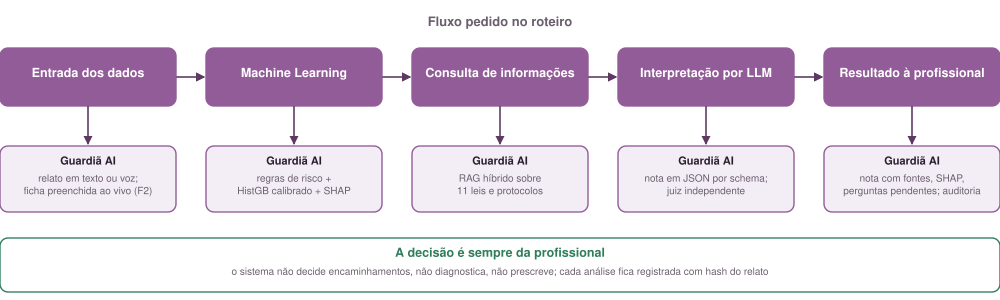

*Figura 1 · O fluxo pedido no roteiro (entrada → ML → consulta → LLM → resultado) e como cada etapa foi implementada.*

## 1. Problema e cenário escolhido

Uma instituição que atende mulheres recebe, no mesmo atendimento, relato em texto livre, dados cadastrais e respostas de formulário. A profissional precisa identificar o que merece atenção, decidir próximos passos e consultar protocolos, muitas vezes com a mulher na sua frente.

Dentre as opções fornecidas como tema para este *tech challenge*, escolhemos **segurança: violência doméstica e familiar**. A dimensão de saúde entra dentro da jornada (encaminhamentos de saúde e a norma técnica do Ministério da Saúde sobre violência sexual), não como um segundo fluxo. Dois escopos dobrariam teste, demonstração e relatório sem ganhar nenhum requisito.

**Para quem:** profissionais de assistência social, enfermagem, psicologia e atendimento em DEAM, CREAS e Casa da Mulher Brasileira.

**O que não faz:** não decide encaminhamento, não substitui o registro oficial, não diagnostica, não prescreve. A decisão é sempre da profissional.

## 2. Dados

**Fonte.** SINAN/DATASUS, notificações de violência interpessoal e autoprovocada no Brasil em 2024: 662.803 notificações e 160 campos, dados públicos e anonimizados. A extração DBC → parquet é herdada do TC1.

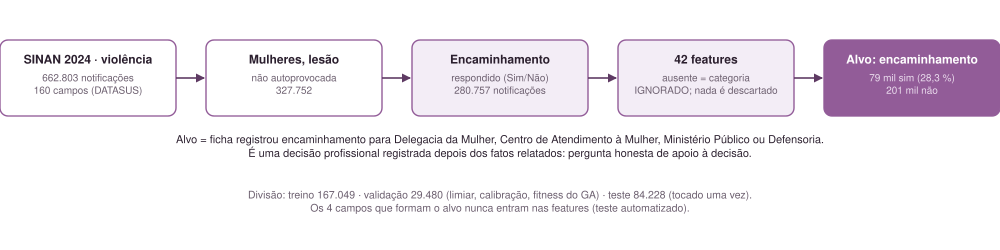

*Figura 2 · Do arquivo bruto à tabela de treino.*

**Filtro.** Mulheres (`CS_SEXO = F`), lesão não autoprovocada (`LES_AUTOP = 2`) e pelo menos um dos quatro campos de encaminhamento à rede de proteção respondido. Resultado: **280.757 notificações**.

**Alvo: `ENCAMINHA_PROTECAO`.** Vale 1 quando a ficha registra encaminhamento para Delegacia da Mulher, Centro de Atendimento à Mulher, Ministério Público ou Defensoria Pública. Prevalência: **28,3%**.

**Features (42).**

| Grupo | Campos |
| --- | --- |
| Tipo de violência (10, binários) | física, psicológica, sexual, tortura, financeira, negligência, trabalho infantil, intervenção legal, tráfico, outra |
| Meio de agressão (9, binários) | ameaça, força corporal, objeto contundente, cortante, quente, enforcamento, envenenamento, arma de fogo, outro |
| Relação com o autor (5, binários) | parceiro íntimo, familiar, conhecido, institucional, outros |
| Contexto (13, nominais) | repetição (`OUT_VEZES`), álcool, sexo do autor, número de envolvidos, raça/cor, ciclo de vida, situação conjugal, gestação, orientação sexual, identidade de gênero, deficiência, local, motivação |
| Demais | UF, escolaridade ordinal e idade em anos (cada uma com indicador de ausência) |

**Preparação.** Campos em branco ou "ignorado" viram a categoria `IGNORADO`: nada é descartado por valor ausente, ao contrário do TC1, que perdeu 81% das linhas com `dropna()`. Foram removidos dia da semana, mês e circunstância CID (60% vazia). Um `ColumnTransformer` aplica one-hot nas nominais, mediana nas numéricas e passagem direta nas binárias, dentro de um `Pipeline` ajustado só no treino. A mesma função transforma um caso vindo do formulário web, o que impede divergência entre treino e inferência. Os quatro campos que formam o alvo nunca entram nas features; um teste automatizado garante isso. Notebook: `notebooks/02_preprocessing.ipynb`.

## 3. Modelos de machine learning

Comparamos três famílias de modelo de classificação, todas sobre o mesmo pré-processamento (§2), para que a diferença entre elas venha só do algoritmo. A quarta linha é o Random Forest com os hiperparâmetros escolhidos por busca evolutiva.

| Modelo | Como funciona | Por que está na comparação | Configuração usada |
| --- | --- | --- | --- |
| Regressão Logística | Soma ponderada das features passada por uma função logística; cada coeficiente diz quanto a feature aumenta ou reduz a chance de encaminhamento | Baseline linear e interpretável: mostra quanto os modelos de árvore ganham de fato | `class_weight="balanced"`, C = 0,5 |
| Random Forest | Centenas de árvores de decisão treinadas em amostras diferentes dos dados; a probabilidade é a média dos votos | Captura interações entre features (arma + parceiro íntimo, por exemplo) sem engenharia manual; herança do TC2 | 250 árvores, profundidade 14, 10 amostras por folha, `class_weight="balanced_subsample"` |
| Random Forest + algoritmo genético | O mesmo modelo, com hiperparâmetros escolhidos por busca evolutiva: 6 configurações por geração, 4 gerações, elitismo 2, cruzamento e mutação (30%), fitness = 0,5·PR-AUC + 0,3·recall + 0,2·F1 na validação | Testa se afinar o Random Forest compensa frente aos valores fixos; continuidade do TC2 | Melhor configuração encontrada: 150 árvores, profundidade 20, 10 amostras por folha, 30% das features por divisão |
| HistGradientBoosting | Árvores rasas treinadas em sequência, cada uma corrigindo os erros da anterior, sobre histogramas das features | Estado da arte para dados tabulares; rápido (13 s de treino), leve (0,5 MB) e trata categóricas nativamente | Taxa de aprendizado 0,06, até 400 iterações com parada antecipada, 31 folhas, `class_weight="balanced"` |

**Protocolo.** Divisão entre teste/treino 70/30 estratificada (semente 42). Dentro do treino, 15% viram validação para escolher o limiar, ajustar a calibração e servir de fitness ao algoritmo genético. O conjunto de teste é tocado uma única vez. Notebook: `notebooks/03_model_comparison.ipynb`; código: `src/guardia/ml/train.py`.

### 3.1 Resultados no conjunto de teste (84.228 notificações)

| Modelo | PR-AUC | ROC-AUC | Recall | Precisão | F1 | Especificidade | Limiar |
| --- | --- | --- | --- | --- | --- | --- | --- |
| Regressão Logística | 0,612 | 0,777 | 0,906 | 0,375 | 0,531 | 0,406 | 0,31 |
| Random Forest | 0,652 | 0,803 | 0,930 | 0,378 | 0,537 | 0,396 | 0,31 |
| **HistGradientBoosting (implantado)** | **0,674** | **0,816** | **0,923** | **0,392** | **0,551** | 0,437 | 0,29 |
| Random Forest + GA | 0,680 | 0,819 | 0,918 | 0,401 | 0,558 | 0,460 | 0,28 |

Referências: acurácia da classe majoritária 0,717; PR-AUC de um modelo aleatório 0,283.

**Como ler os números.** Recall 0,92 quer dizer que, de cada 100 mulheres que foram encaminhadas, o modelo apontou 92; os 8 casos perdidos são o erro mais caro, e por isso o ponto de corte é baixo. Precisão 0,39 quer dizer que, de cada 100 sugestões do modelo, 39 batem com a ficha; os outros 61 são alarmes a mais, que custam uma conversa com a equipe. Aceitamos mais alarmes para perder menos casos, e o limiar foi escolhido pelo F2, que pesa o recall quatro vezes mais que a precisão.

PR-AUC e ROC-AUC medem se o modelo ordena bem os casos do mais ao menos provável, independentemente do ponto de corte. PR-AUC 0,67 contra 0,28 de um chute aleatório mostra que ele ordena bem; as diferenças entre os quatro modelos são pequenas, e os de árvore ficam acima da regressão logística. A acurácia não está na tabela porque enganaria: "nunca sugerir" acertaria 72%. A probabilidade mostrada na tela é calibrada: "42%" significa que cerca de 4 em 10 casos com esse perfil foram encaminhados em 2024.

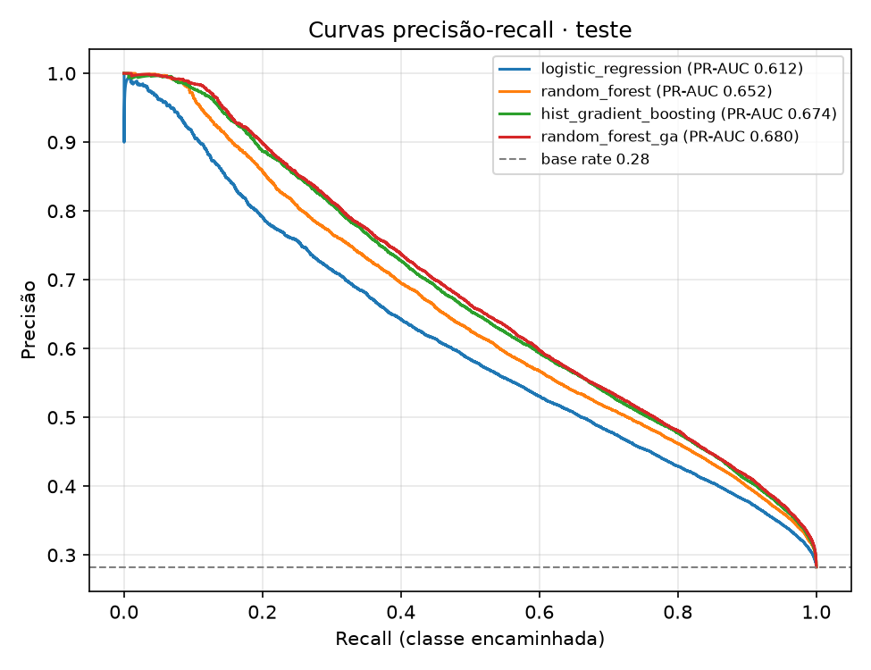

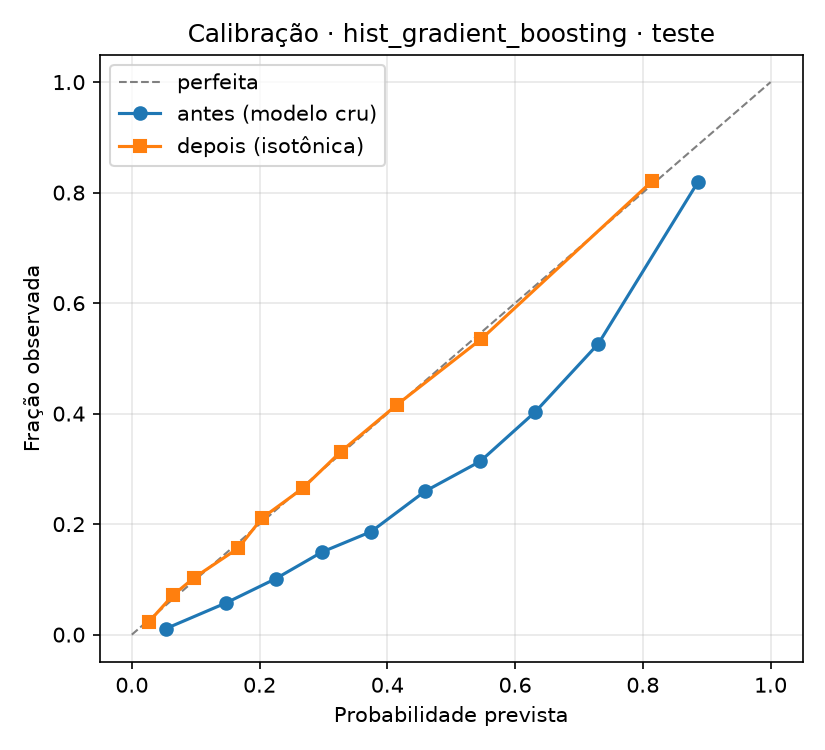

*Figura 3 · Curvas precisão-recall no teste (esquerda) e calibração do modelo implantado (direita): Brier 0,174 → 0,146.*

**Seleção.** O Random Forest com GA tem o melhor PR-AUC, mas supera o HistGradientBoosting por 0,006, abaixo da regra de 0,01 fixada antes de olhar o teste. O HistGradientBoosting cabe em 0,5 MB, treina em 13 s e explica em milissegundos; é o modelo implantado, com ponto de corte calibrado em 15%.

**Equidade.** Recall por raça/cor no teste: preta 0,950, amarela 0,946, branca 0,924, parda 0,920, ignorada 0,873 e **indígena 0,770** (952 casos). O gap de 0,18 é reportado e explicado na interface: o modelo aprende a prática registrada em 2024, inclusive sub-encaminhamento regional e por grupo. Por isso a interface diz "perfil encaminhado em 2024", nunca "deve ser encaminhada".

## 4. Interpretabilidade

**SHAP** (`TreeExplainer`) em dois níveis. Global, sobre uma amostra do teste: idade, parceiro íntimo como autor, motivação por sexismo, ameaça, autor homem e repetição são os fatores que mais pesam. Por caso, na interface: os seis fatores de maior |SHAP| aparecem na nota com o sentido (aumenta ou reduz a probabilidade) e são passados à LLM, que os traduz para a profissional. Para a regressão logística, as contribuições coeficiente × valor cumprem o mesmo papel no notebook.

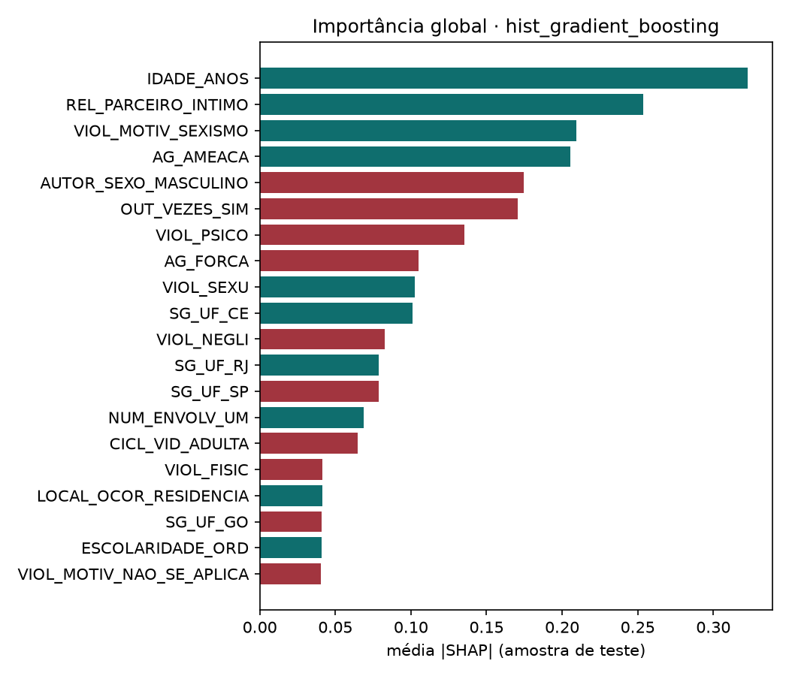

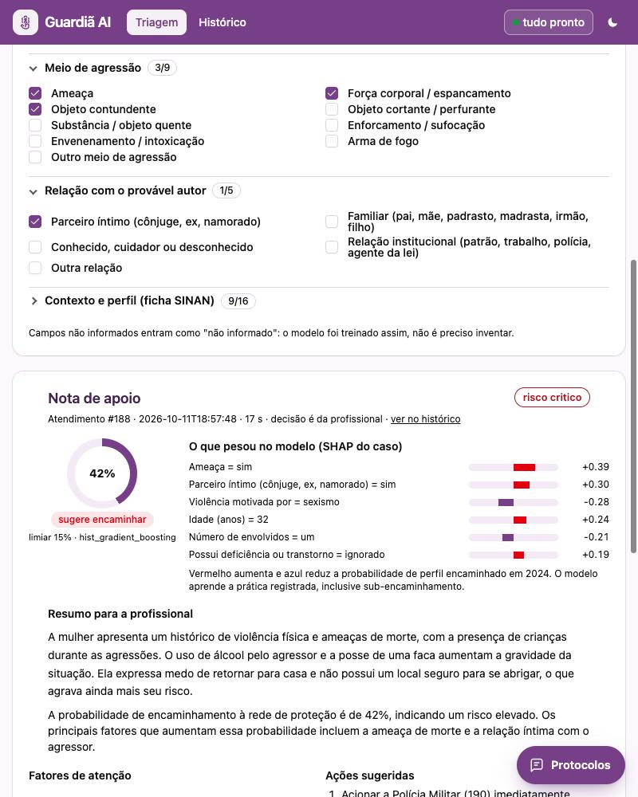

*Figura 4 · SHAP global do modelo implantado (esquerda) e SHAP do caso na nota de apoio (direita), com a probabilidade calibrada, o limiar e a leitura do modelo em texto.*

## 5. Fluxo da aplicação (LangGraph)

A interface é um site simples em Python (FastAPI e htmx), sem framework de front-end; a stack não é o foco do trabalho. O fluxo principal é um **LangGraph de 9 nós**, todos lendo e escrevendo o mesmo estado. A análise roda em segundo plano no servidor e a tela mostra o progresso de cada etapa enquanto a profissional continua editando a ficha.

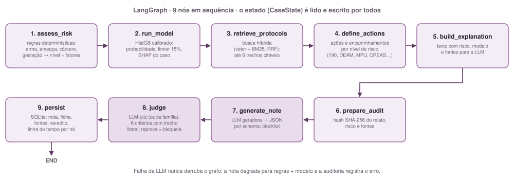

*Figura 5 · Os 9 nós do grafo de triagem e o que cada um produz.*

| Nó | O que faz |
| --- | --- |
| `assess_risk` | regras determinísticas sobre texto, ficha e sinais (arma, ameaça de morte, cárcere, repetição, gestação, filhos, local seguro) → nível baixo, moderado, alto ou crítico e lista de fatores |
| `run_model` | probabilidade calibrada, limiar, sugestão e SHAP do caso |
| `retrieve_protocols` | busca híbrida na base de protocolos; guarda quais documentos contribuíram |
| `define_actions` | ações e encaminhamentos por nível de risco e sugestão do modelo (190, DEAM, medida protetiva, Casa da Mulher Brasileira, CREAS, Defensoria e MP, Ligue 180, saúde em violência sexual) |
| `build_explanation`, `prepare_audit` | texto para a LLM; hash SHA-256 do relato, risco e fontes |
| `generate_note` | a LLM geradora recebe relato, ficha, risco, leitura do modelo, trechos e ações e devolve a nota em JSON restrito por schema; blocklist em seguida |
| `judge` | LLM-as-judge em outro provedor; reprovação bloqueia a nota |
| `persist` | SQLite com hash do relato, risco, probabilidade, ficha, fontes, veredito, latências e linha do tempo por nó |

A jornada acontece em uma única tela, em cinco passos:

1. **Relato.** A profissional escreve ou dita o relato. Enquanto ela conta, um modelo rápido preenche a ficha do SINAN e um guia mostra as perguntas do Formulário Nacional de Avaliação de Risco que ainda faltam.
2. **Análise.** Ao clicar em Analisar, o grafo roda em segundo plano (regras → modelo → protocolos → LLM → juiz) e a tela mostra o progresso de cada etapa.
3. **Nota de apoio.** Risco, probabilidade com os fatores SHAP, resumo, ações, encaminhamentos, perguntas pendentes e protocolos citados, com o aviso de que a decisão é da profissional. Um painel recolhido mostra as etapas e o rastro técnico, incluindo o veredito do juiz.
4. **Protocolos.** A qualquer momento, um painel lateral responde perguntas sobre leis e protocolos usando o caso em andamento como contexto e citando as fontes.
5. **Histórico.** Cada análise fica registrada com hash do relato, nota, modelo, fontes e veredito.

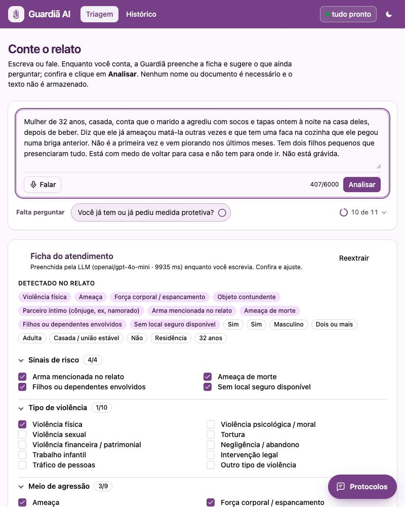

*Figura 6 · Tela inicial: relato digitado, guia com a única pergunta que falta (10 de 11 tópicos cobertos) e ficha preenchida pela LLM com os sinais de risco marcados.*

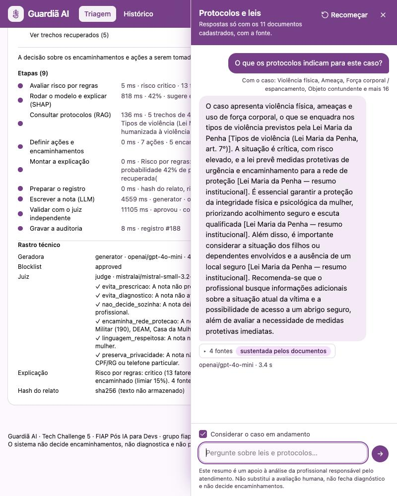

*Figura 7 · Painel de protocolos (RAG): "O que os protocolos indicam para este caso?" respondida com os fatos da ficha como contexto e 4 fontes citadas.*

## 6. Integração com a LLM

Três papéis, cada um num endpoint compatível com a API da OpenAI configurado por variáveis de ambiente, com saída estruturada por `response_format=json_schema` (fallback `json_object` + validação):

| Papel | Variáveis | Modelo (via OpenRouter) |
| --- | --- | --- |
| Geradora da nota (F1) e do chat (F3) | `LLM_*` | `openai/gpt-4o-mini` |
| Juiz | `JUDGE_*` | `mistralai/mistral-small-3.2-24b-instruct` |
| Extração ao vivo da ficha (F2) | `FAST_*` | `google/gemini-2.5-flash-lite` |
| Transcrição de voz | `TRANSCRIBE_*` | `google/gemini-2.5-flash` (áudio) |

Regra fixa: **o juiz nunca é da mesma família que a geradora**. Na configuração padrão são três famílias (OpenAI, Mistral, Google). O cliente registra backend, modelo, latência e tokens de cada chamada; o LangSmith rastreia cada nó.

**Onde a LLM entra.** (1) F2: transforma o relato livre nos campos da ficha, com lista de campos incertos e, para o guia, os tópicos que o relato já respondeu com o trecho literal correspondente. (2) F1: escreve a nota a partir do que o grafo já calculou (risco, modelo, SHAP, trechos, ações); ela não decide risco nem encaminhamento, traduz. (3) F3: responde perguntas restritas aos trechos recuperados, declarando cobertura e fontes. (4) Juiz: audita cada nota.

Os mesmos papéis foram validados com modelos abertos auto-hospedados (Qwen em vLLM num pod de GPU), com qualidade equivalente e 2,5 vezes mais lentos; a configuração padrão é a do OpenRouter, a cerca de US$ 0,002 por análise.

## 7. Funcionamento do RAG

**Base de conhecimento:** 11 documentos públicos em texto (Lei Maria da Penha, medidas protetivas, canais de atendimento, rede de proteção do DF, LGPD e norma técnica do Ministério da Saúde sobre violência sexual), 98 KB no total.

| Etapa | Ferramenta |
| --- | --- |
| Normalização e fatiamento | texto limpo (hífens de quebra, linhas partidas, formulários descartados) em 227 trechos de 450 caracteres, com `RecursiveCharacterTextSplitter` do LangChain |
| Embeddings | `paraphrase-multilingual-MiniLM-L12-v2` (sentence-transformers) |
| Índice vetorial | Chroma, distância cosseno, persistido dentro da imagem Docker |
| Índice lexical | BM25 implementado no projeto, sobre tokens sem acento e sem stopwords |
| Fusão (busca híbrida) | Reciprocal Rank Fusion (k = 60) dos dois rankings; no máximo 2 trechos por documento e um trecho-chave por tema |
| Geração | LLM geradora com saída JSON por schema: resposta, cobertura (total, parcial ou nenhuma) e fontes citadas |
| Orquestração | nó `retrieve_protocols` do LangGraph (F1) e chat com memória no servidor (F3) |

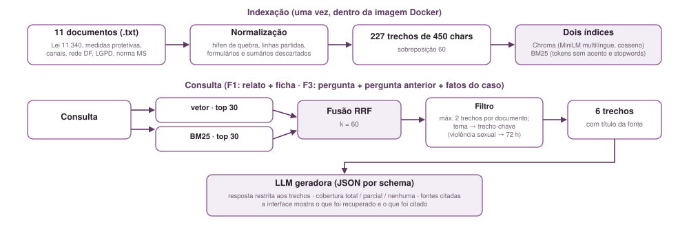

*Figura 8 · Indexação e consulta: busca vetorial e BM25 fundidas por Reciprocal Rank Fusion, filtro por documento e trecho-chave por tema.*

**Citação da fonte.** Cada trecho carrega o título do documento. A nota lista os títulos usados; a interface mostra todos os recuperados, destaca os citados e permite ler os trechos. No chat, as citações aparecem entre colchetes dentro da resposta.

## 8. Segurança e responsabilidade

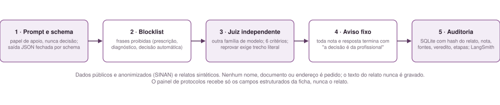

*Figura 9 · Cinco camadas entre a LLM e a profissional.*

- **Dados.** Só dados públicos e anonimizados (SINAN) e relatos sintéticos; a interface não pede nome, documento ou endereço, e o relato vira hash SHA-256 antes de ser gravado.
- **Apoio, não decisão.** Prompt, schema e aviso fixo em toda nota; quando falta informação, a nota lista o que perguntar em vez de concluir, e o chat declara "sem cobertura".
- **Blocklist** de frases de prescrição, diagnóstico e decisão automática, aplicada antes do juiz.
- **Juiz independente**, sempre de outra família de modelo, com seis critérios; reprovar exige trecho literal da nota, e a reprovação bloqueia a nota com o motivo na tela.
- **Registro.** Cada análise grava hash do relato, ficha, risco, probabilidade, SHAP, fontes, veredito do juiz e a duração de cada nó (§5); o LangSmith guarda o rastro das chamadas.

## 9. Avaliação da aplicação

O SINAN não tem texto livre. Para avaliar o pipeline de ponta a ponta, a geradora escreveu **60 relatos sintéticos** a partir de fichas reais (`make synth`), cujos campos servem de rótulo de graça. Sobre 30 deles, `make eval` mede a extração (F2), a geração e o juiz (F1):

| Medida | Resultado |
| --- | --- |
| F2 · precisão / recall por campo binário | 0,90 / 0,95 |
| F2 · acerto de `OUT_VEZES` | 90% |
| F1 · notas geradas e aprovadas pelo juiz | 30 / 30 |
| F1 · latência mediana da LLM / total | 5,1 s / 20 s |
| F1 · fontes recuperadas / citadas por nota | 2,8 / 2,0 |
| Concordância sugestão do modelo × encaminhamento da ficha | 0,80 |

Leitura: a extração acerta nove de cada dez campos; todas as notas passaram no juiz; o modelo concorda com o encaminhamento real em 80% dos casos, medido sobre fichas reconstruídas pela LLM a partir do texto, o que inclui o erro de extração.

**Avaliação sem LLM** (`make eval-rag`, `docs/eval_rag.json`): 18 perguntas do chat com documento esperado e os 60 relatos sintéticos. Resultado: **18 de 18 perguntas** com o documento certo no top-6 (12 de 18 antes da busca híbrida), 60 de 60 relatos com o documento esperado (52 antes) e o trecho das 72 h em 10 de 10 casos de violência sexual (2 antes).

## 10. Execução e entrega

Código, notebooks (`02_preprocessing`, `03_model_comparison`) e scripts estão no repositório, com README de instruções, Dockerfile (imagem com modelo treinado, protocolos e índice RAG; LLM remota por variável de ambiente) e CI que roda lint, 44 testes e o build da imagem. A aplicação roda num pod de CPU do RunPod com LLM via OpenRouter; o modelo está publicado no Hugging Face; o vídeo de apresentação está em [youtu.be/6B63cgtWGmk](https://youtu.be/6B63cgtWGmk).

## 11. Limitações

- **O alvo é a prática registrada em 2024**, não um padrão-ouro de quem deveria ser encaminhada. O modelo reproduz sub-encaminhamento (gap de recall de 0,18 entre grupos de raça/cor) e a interface diz isso.
- **Transversal.** Não prevê desfecho futuro; apoia a leitura do caso presente.
- **Relatos sintéticos** substituem relatos reais na avaliação: a concordância do F2 mede consistência, não verdade. Falta validação com profissionais da rede.
- **Base RAG pequena** (11 documentos) e concentrada no DF; respostas fora dela são sinalizadas como sem cobertura.
- **Dependência de LLM remota.** Sem ela, a nota degrada para regras + modelo, com a falha registrada; a configuração auto-hospedada custa um pod ligado.
- **O juiz reduz, não elimina**, respostas inadequadas. A decisão é da profissional.

**Próximos passos.** Validar com profissionais da rede de proteção e ampliar a base de protocolos com normas estaduais.
